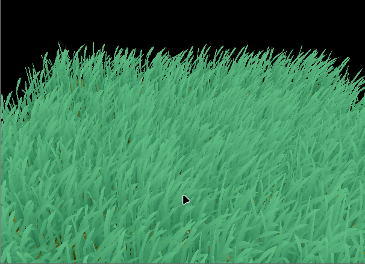
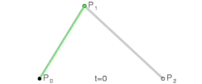
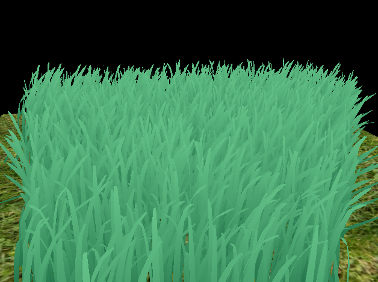

Vulkan Grass Rendering
==================================

**University of Pennsylvania, CIS 565: GPU Programming and Architecture, Project 5**

* T Fong
  * [LinkedIn](https://www.linkedin.com/in/tzfong/), [personal website](https://www.tzfong.com/)
* Tested on: Windows 11, Intel Ultra9 275HX (2.70 GHz), RTX 5070 Mobile, 32 GB RAM (5600 MT/s)

### Grass Rendering in Vulkan

### A bit of basecode housekeeping
Before I got started, I had to change the CMakeLists version (it was old), and I noticed that the existing basecode causes several validation layer warnings, including some leaked Vulkan objects (e.g. the surface is not destroyed). The basecode also uses render passes (which is deprecated), which I switched to dynamic rendering.

Because I've thus far rather enjoyed working with it and it seems to be quite popular, I opted to write my shaders in Slang. The grass shaders are all in `tessellation.slang`, the basic graphics pipeline is in `graphics.slang`, and the compute pass is in `compute.slang`.

### Some background
Foliage can be a bit of a tricky thing to render; because there's so much of it and you want to capture detail, a lot of systems have traditionally used image-based techniques like grass cards to render it. I've personally never minded how it looks, but it does result in pretty visible artifacts. Rendering each individual blade of grass would not only do away with a lot of these artifacts, but actively allow for better physical effects. [This paper](https://www.cg.tuwien.ac.at/research/publications/2017/JAHRMANN-2017-RRTG/JAHRMANN-2017-RRTG-draft.pdf), which this project is an implementation of, presents a method for doing so in real time, using tessellation.

### The representation of grass

The paper represents a blade of grass as a bezier curve, with 3 control points (`v0`, `v1`, `v2`), width, height, an up vector, stiffness, and a facing direction. We generate the geometry we need to render the grass on the GPU using tessellation. Tessellation adds three new stages to the graphics pipeline between the vertex shader and rasterization, two of which are programmable and one of which is fixed function. Since the tessellation stages ultimately generate the geometry we use, the vertex shader is no longer the stage at which our geometry gets squished into clip space; that gets done at the tessellation evaluation (or domain shader) stage, but more on that in a bit.

The tessellation control shader (or hull shader), essentially dictates the way the geometry will be subdivided. If we imagine the output, higher-res geometry as being specified by the input lower-res geometry (patches, defined by control points), then the tessellation control shader takes in input patches and produces output patches. We specify a lot about how we want the tessellator (the fixed function stage) to go about subdividing the geometry, then specify the subdivisions we want. In our case, each patch is defined by a single control point, which contains all of the grass blade information mentioned above (where orientation is stored in the `w` element of `v0`, `height` in the `w` element of `v1`, `width` in the `w` element of `v2`, and `stiffness` in the `w` element of `up`).

Here, we specify that we want to subdivide into quads. It was definitely rather difficult to wrap my mind around this at first, but I think it's best to imagine, abstractly, a square with u and v axes, completely detached from any real sense of space. The way that square is divied up, that is, where we place smaller points on its edges and on the inside, is what we dictate.

Once we get to the tessellation evaluation stage, or domain shader, we decide what to do with these new (u, v) points. This is really left up to you to decide, so I decided that the v would parameterize across the blade of grass, and u would parameterize up and down the blade of grass. There isn't much interesting to do with v, but I use u as the factor by which we compute points along the bezier curve defining the shape of the grass blade with De Casteljau's algorithm (shoutout CIS 5620). Without diving into De Casteljau's, it allows you to compute points along a bezier curve by performing repeated linear interpolations, making it quite simple. Here's a gif showing how it works:

Once we've computed the actual location of the geometry, we project it down into clip space, where it is then rasterized, and we perform our fragment shader on it.

### Compute culling of grass blades
With so many grass blades, we'd like to make sure we're only drawing the grass blades that really matter. To that end, we can use a compute shader along with indirect draws to optimize the grass rendering. Indirect draws allow the GPU to specify what we're drawing, where typically the programmer would control this themselves on the CPU. We use a compute shader to populate a buffer with the grass blades we intend to draw, along with the indirect draw buffer that specifies the details.

#### Frustum culling
First off, it doesn't make sense to draw grass blades we can't see. We'll use a bit of a trick to decide whether or whether not we can see a grass blade; we'll compute the approximate screen space coordinates of `v0`, `v2`, and an estimated middle point `m`. If all three lie outside of the [-1, -1] to [1, 1] bounds of the screen, then we won't draw it (I've tweaked this parameter in my own code for illustrative purposes).

With more aggressive culling, you can see what this is doing:
  
*Here I set my LENIENCE macro to 0.8, meaning anything outside of the [-0.8, -0.8] to [0.8, 0.8] range gets culled.*

#### Distance culling
While I do lower the LOD of the tessellation as the grass blades get further from the camera, it also makes sense to just not draw them in the first place as they get further. After all, each blade of grass becomes harder to see. I thus bucket the grass by distance, with a safe radius macro, and thin the grass with distance, until a max distance beyond which no grass is rendered. This is pretty prominently demonstrated in the demo gif at the top of the README, but I do this by first calculating what distance bucket a blade of grass would fall into by taking the distance from `v0` to the camera, then subtracting a safe radius and dividing it by the number of buckets. I then thin by about half per each bucket with some bitwise operations:  
`if ((gThreadIdx.x & ((1 << (int(CULLING_BUCKETS) + 1)) - 1)) >= (1 << (int(CULLING_BUCKETS) + 1 - bucketNum))) return;`

The result is rather aggressive here, but it's moreso a demonstration of the approach, given the plane is not very large in the first place.

#### Orientation culling
The grass blades are essentially infinitely thin. Thus at grazing angles they become hardly visible. We can therefore also perform a simple culling check by taking the dot product of the direction at which the camera is viewing the grass blade and the direction it is facing, cutting it off below a certain threshold.

### Benchmarking

#### Frustum culling lenience
| Lenience | Visible blades | Compute (ms) | Grass (ms) |
|---:|---:|---:|---:|
| 0.80 | 5175 | 0.137 | 0.121 |
| 0.90 | 5463 | 0.145 | 0.124 |
| 0.95 | 5531 | 0.159 | 0.127 |
| 1.10 | 5651 | 0.146 | 0.123 |
| 1.50 | 5676 | 0.161 | 0.126 |
| 2.00 | 5680 | 0.145 | 0.127 |

#### Distance culling: max distance (4 buckets)
| Max distance | Visible blades | Compute (ms) | Grass (ms) |
|---:|---:|---:|---:|
| 8 | 402 | 0.009 | 0.023 |
| 12 | 1640 | 0.022 | 0.067 |
| 16 | 3001 | 0.043 | 0.094 |
| 24 | 4799 | 0.115 | 0.119 |
| 32 | 5531 | 0.159 | 0.127 |
| 64 | 6949 | 0.256 | 0.148 |

#### Distance culling: number of buckets (max distance 32)
| Buckets | Visible blades | Compute (ms) | Grass (ms) |
|---:|---:|---:|---:|
| 1 | 6950 | 0.243 | 0.146 |
| 2 | 6948 | 0.240 | 0.146 |
| 3 | 6338 | 0.218 | 0.144 |
| 4 | 5531 | 0.159 | 0.127 |
| 6 | 4464 | 0.138 | 0.122 |
| 8 | 3640 | 0.084 | 0.111 |

#### Tessellation factors
| U factor (V = 2) | Grass (ms) |
|---:|---:|
| 1 | 0.079 |
| 2 | 0.084 |
| 4 | 0.096 |
| 8 | *.127 |
| 16 | 0.188 |

| V factor (U = 8) | Grass (ms) |
|---:|---:|
| 1 | 0.133 |
| 2 | 0.127 |
| 4 | 0.176 |
| 8 | 0.281 |
| 16 | 0.495 |